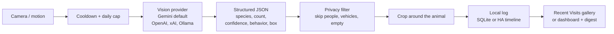

# Backyard Wildlife

A privacy-first AI camera kit that identifies the animals visiting a backyard
(or a garden bench, or a shop doorway) and keeps a local Recent Visits
gallery of cropped stills. People are skipped. API keys stay in the
environment. Nothing in this repository is published for you — you choose
when, and whether, to push it.

It runs two ways:

- A **Home Assistant package and blueprint** that call [LLM Vision](https://github.com/valentinfrlch/ha-llmvision) (Gemini by default, with OpenAI, xAI, and local Ollama as alternates).
- A **standalone Python app** on a Raspberry Pi or any Linux box, with OpenCV motion detection, a pluggable vision provider, a SQLite log, and a tiny web gallery.

The same pattern — motion, cooldown, a structured vision call, a privacy filter, a crop, a local log — also works for a small business, such as tagging storefront or parking-lot activity or spotting pests in a garden center. See [docs/small-business.md](docs/small-business.md).

## The problem

A yard camera already knows when something moved. It does not tell you
whether that something was a cottontail, a squirrel on the fence, or a
person walking through. Cloud "AI camera" features are often locked to one
vendor, hard to cap, and happy to file people next to wildlife.

This kit does one job: on motion, send a still (or a short clip, in Home
Assistant) to a vision model, get JSON back (`species`, `count`,
`confidence`, `behavior`, a bounding box), drop anything with a person in
it, crop around the animal, and log the visit locally.

## Demo

The `samples/` folder is **synthetic** — simple illustrated frames, not
photographs of a real yard or of real people. You can run the whole pipeline
without an API key:

```bash
python -m backyard_wildlife analyze --dry-run samples
python -m backyard_wildlife digest
python -m backyard_wildlife gallery    # http://127.0.0.1:8080/
```

Dry-run keeps the rabbit, squirrel, cardinal, and beetle, crops each around
its box, and filters out the person silhouette and the empty yard. The
gallery shows animals only.

## Quick start (Python)

```bash
python3 -m venv .venv
source .venv/bin/activate
pip install -e ".[dev]"
python scripts/generate_samples.py     # recreates samples/ if needed
python -m backyard_wildlife analyze --dry-run samples --json
pytest
```

To use a live camera later, copy `config.example.yaml` to `config.yaml` and
`.env.example` to `.env`, add a Gemini key from
[Google AI Studio](https://aistudio.google.com/apikey), and run
`python -m backyard_wildlife watch`. Full steps are in
[docs/raspberry-pi.md](docs/raspberry-pi.md).

## Quick start (Home Assistant)

1. Install [LLM Vision](https://github.com/valentinfrlch/ha-llmvision) and add a Gemini (or OpenAI, xAI, Ollama) provider.
2. Copy `homeassistant/packages/backyard_wildlife.yaml` into `config/packages/`, or import `homeassistant/blueprints/backyard_wildlife.yaml`.
3. Replace the example `camera.backyard` / `binary_sensor.backyard_motion` entity IDs with your own.
4. Paste the LLM Vision **provider id** (not the API key) into `input_text.wildlife_provider_id`.
5. Copy `homeassistant/www/wildlife-visits-card.js` to `config/www/` and add it as a Lovelace module resource. The Recent Visits card crops each animal on screen.

Defaults: a **5-minute per-camera cooldown**, a **150-call daily cap**,
**1024-pixel** frames, notifications **off**. Details are in
[docs/home-assistant.md](docs/home-assistant.md).

## How it fits together



## What is generic, and what was verified

The defaults follow a real Home Assistant deployment (LLM Vision, Gemini as
of 18 November 2026, a Grok/xAI provider kept as a rollback, 5-minute
cooldown, 150 calls a day, 1024-pixel frames, animal-only Recent Visits with
an on-screen crop from a box returned in the same call). This repository is
**not** a copy of that household's configuration. Camera names, entity IDs,
provider ids, recordings, and location hints have been replaced with
placeholders. Sample images are drawn, not captured.

## Docs

- [Hardware list](docs/hardware.md)
- [Home Assistant setup](docs/home-assistant.md)
- [Raspberry Pi setup](docs/raspberry-pi.md)
- [Costs and free-tier limits](docs/costs.md)
- [Privacy and ethics](docs/privacy.md)
- [Troubleshooting](docs/troubleshooting.md)
- [Small-business uses](docs/small-business.md)
- Prompt library in [`prompts/`](prompts/)

## Credit

Designed and documented by **Elder Lira**, from a backyard camera workflow,
for a public AI-use-case portfolio. Contributions that keep the privacy
rules intact are welcome.

## License

[MIT](LICENSE)
